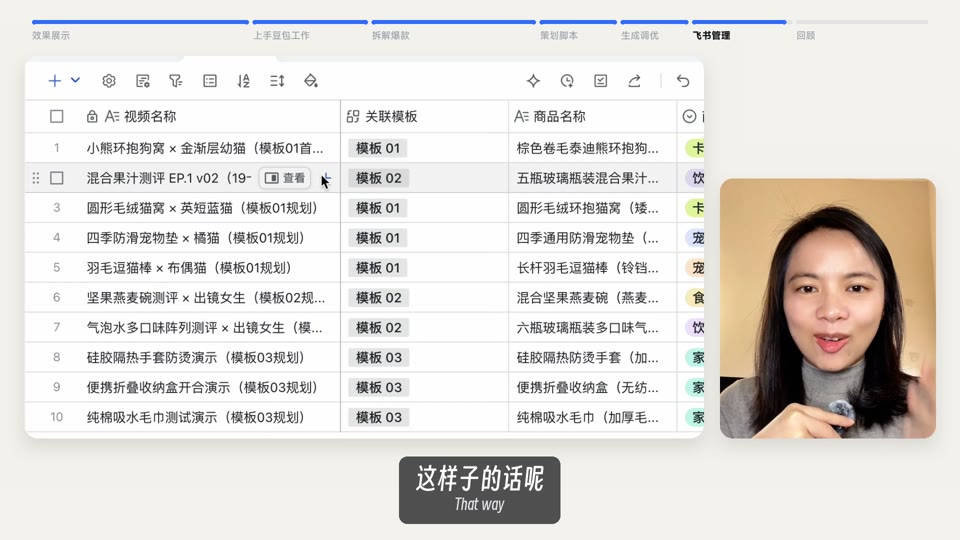

# 横版课程剪辑（course-landscape-edit）

让 Claude Code、Codex 等 AI Agent 把真人讲课口播剪成统一风格的 16:9 横版课程视频：

- **分屏骨架**：左边 16:9 内容区放课件、录屏或动效卡，右边一个竖版人像小窗，米白画布、圆角投影。
- **开场对比**：全屏并排放「原爆款」和「生成」两条竖版视频，三组之后接「一键完成」标题卡。
- **课件（PPT）**：封面、目录、章节页、步骤提示词页（可暂停照抄）、回顾、下集预告，全部 HTML 模板。
- **动效卡**：否定清单、能力拼图、分类对比、关键词放大、技巧卡、数据闭环、对话示范等 7 种，卡在字幕句首出现。
- **录屏镜头**：固定或快推后定住，不做缓慢推拉；只展示有数据的部分。
- **顶部章节进度条 + 中英双语字幕**。

时间轴结构、版式、PPT 样式定死，保证每一集是同一个系列；动效和转场在同一风格下每集都可以做得更好。每一步都会先给你看关键帧，你确认了再合成整片。

样板片：豆包工作 × 电商 第 1 集（8 分 34 秒）。`scripts/` 是这条片子的剪辑工程，`examples/` 是它的时间轴文件和截图。

| 开场对比 | 标题卡 | 提示词课件 |
|---|---|---|
|  |  |  |
| **录屏快推** | **对话示范动效** | **结果页** |
|  |  |  |

## 电脑要求

- macOS、Linux 或 Windows 10/11（Windows 建议在 Git Bash 或 WSL 里跑 `new_project.sh`）。
- 装好 [Claude Code](https://claude.com/claude-code) 或 [Codex](https://github.com/openai/codex) 中的任意一个（其他 Agent 读 AGENTS.md 也能用）。
- ffmpeg、Python 3.10+、Node.js（安装脚本会帮你装）。
- 渲染是纯 CPU，8 分半的片子 4 段并行约 12 分钟。

## 安装

见仓库首页 [README](../../../../README.md)：Claude Code 用插件市场一键装；其他 Agent 运行 `bash install.sh course-landscape-edit`。第一次用时 Agent 会自己跑 `check.sh`，缺什么就跑 `install.sh` 装好（Python 环境、Playwright、MiSans 字体）。

## 使用

1. 准备好讲课口播原片、这期的课件文案或提示词，以及要用到的录屏和成品视频。
2. 打开 Claude Code 或 Codex，对它说：

   > 用横版课程风格剪 ~/Downloads/lesson.mp4，录屏和成品都在 ~/Downloads/素材/

3. Agent 会依次给你：缺素材清单 → 口播删句确认 → 时间轴 → 关键帧页（改前 / 改后并排）→ 动效小样 → 成片。

出片后要改，Agent 会打开**审片台**（侧边栏或浏览器里的网页）：点时间轴上的元素直接改，写不清的写一句话，点「提交」后回 Agent 说「改好了」，它会出下一版。见[总 README](../../../../README.md#出片后怎么改审片台)。

## 目录

| 路径 | 内容 |
|---|---|
| `SKILL.md` | 给 Agent 的完整规范：画面骨架、时间轴、版式库、动效、字幕进度条、PPT、合成、交付 |
| `scripts/` | 合成器 `compose.py`、粗剪 `build_cut.py`、录屏抽帧 `clips.py`、课件 `slides/`、动效卡 `anim/`、开场对比底图 `cmpfull/`、进度条和标题卡 `kf/`、渲染脚本 `*.js` |
| `fonts/` | 得意黑 Smiley Sans（字幕）、思源黑 Noto Sans SC（课件）。MiSans 由 npm 安装 |
| `examples/` | 第 1 集的 segs / clips / chap / subs / en 和截图 |
| `new_project.sh` | 建一期新工程 |
| `check.sh` / `install.sh` | 依赖自检 / 一键安装（Windows 是 `.ps1`） |
