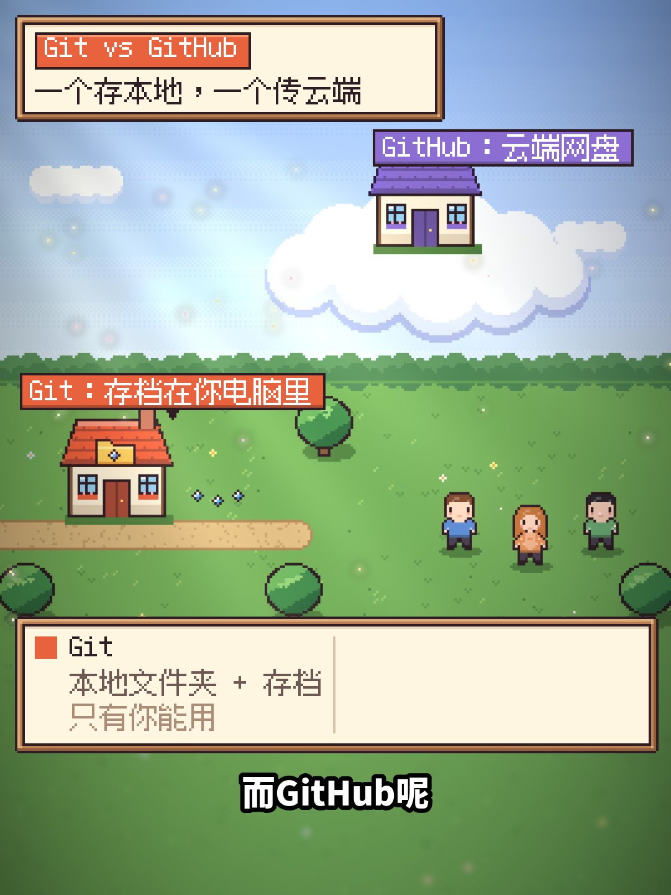
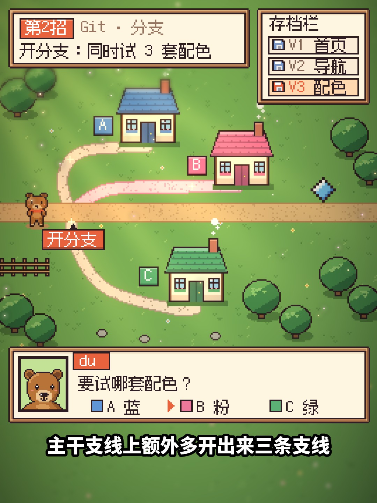

# 像素风剪辑（pixel-edit）

让 Claude Code、Codex 等 AI Agent 帮你把真人口播视频剪成“真人 + 像素小世界”的风格：

- **像素 B-roll**：讲概念时切进星露谷式的 HD-2D 像素场景（存档、上传云端、分支、多人协作……），带光效和 8-bit 音效。
- **像素 Agent 界面**：讲操作时不用录屏，换成像素风的软件界面卡片或清晰的对话截图，像素小助手在旁边陪着。
- **真人小装饰**：开场标题、目录、第 1 招 / 第 2 招等像素小部件。
- **3:4 竖版 + 16:9 横版**：横版沿用竖版时间线，自动加中英双语字幕。
- **封面**：3:4 加字封面，以及 YouTube 16:9、B 站 16:10 和 4:3 横版封面。

每一步都会先给你看关键帧，你确认了再往下做。

样板片：hahadu《Git 和 GitHub 到底是什么》。`scripts/` 里就是这条片子的完整剪辑工程，新片照着它改内容和时间表。

| 竖版 B-roll 示例 | |
|---|---|
|  |  |

## 电脑要求

- macOS、Linux 或 Windows 10/11。
- 装好 [Claude Code](https://claude.com/claude-code) 或 [Codex](https://github.com/openai/codex) 中的任意一个（其他 Agent 读 AGENTS.md 也能用）。
- ffmpeg、Python 3.10+、Node.js（安装脚本会帮你装）。
- 渲染是纯 CPU，4 分钟的片子竖版或横版各约 10 分钟。

## 安装

见仓库首页 [README](../../../../README.md)：Claude Code 用插件市场一键装；其他 Agent 运行 `bash install.sh pixel-edit`。装好后在本目录运行一次 `bash install.sh`（Windows：`install.ps1`）准备 Python 环境和字体依赖。

## 使用

1. 准备好粗剪完的口播原片（已降噪、美颜，最好已经烧录字幕）和这期的文案。
2. 打开 Claude Code 或 Codex，对它说：

   > 用像素风剪辑 ~/Downloads/my-video.mov，文案在 ~/Downloads/script.md

3. Agent 会依次给你：镜头表（哪句用真人、哪句用像素 B-roll、哪句用界面卡片）→ 关键帧 → 开头 1 分钟小样 → 竖版成片 → 需要时出横版和双语字幕 → 封面。

**第一次用之前，先把主角换成你自己的形象**：样板里的棕色小熊是 hahadu 的频道形象。让 Agent“把像素主角换成我的形象”，给它一张你的头像或 logo，它会照同样尺寸画一个替换掉（见 SKILL.md「主角」一节）。

原片没有烧录字幕时，需要转写模型：从 [sherpa-onnx releases](https://github.com/k2-fsa/sherpa-onnx/releases/tag/asr-models) 下载 `sherpa-onnx-sense-voice-zh-en-ja-ko-yue-2024-07-17` 和 `silero_vad.onnx`，放进 `scripts/`。

## 文件说明

| 文件 | 作用 |
|---|---|
| `SKILL.md` | 给 Agent 看的操作手册：镜头类型、技术规格、流程、横版、封面、偏好 |
| `AGENTS.md` | 给 Codex、Cursor 等 Agent 的入口说明 |
| `install.sh` / `install.ps1` | 一键安装 |
| `scripts/world.py` `assets.py` `lib.py` | 像素世界：草地、树、房子、角色、字体 |
| `scripts/bscenes.py` `k4_anim.py` `banim.py` | B-roll 镜头和 HD-2D 光效 |
| `scripts/acards.py` `ccards.py` `pcards.py` | 像素 Agent 界面卡片 |
| `scripts/overlays*.py` `summary.py` `subs.py` | 真人段小装饰、总结卡、字幕 |
| `scripts/render_full.py` | 竖版 3:4 渲染（时间表在 `SEG`） |
| `scripts/r16.py` `render_parts.sh` `cues_bi.json` | 横版 16:9 渲染和双语字幕 |
| `scripts/sfx_*.py` | 8-bit 音效 |
| `scripts/transcribe.py` | 语音转写（SenseVoice） |
| `scripts/cover34.py` `cover_wide.py` | 3:4 加字封面；YouTube / B 站横版封面 |
| `screenshots/` | 对话截图的 HTML 模板和 Playwright 截图脚本 |
| `fonts/` | Fusion Pixel、思源黑体 Heavy、Inter SemiBold、得意黑，都是 SIL OFL 开源字体，可免费商用和分发 |
| `examples/` | 样板片的像素画面截图和主角像素稿 |

## 版权

代码 MIT。字体按各自的 SIL Open Font License。样板里的棕色小熊是 hahadu 的频道形象，请在你的视频里换成自己的。
