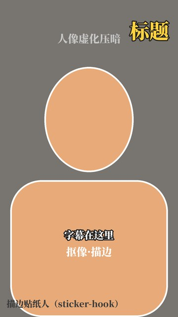
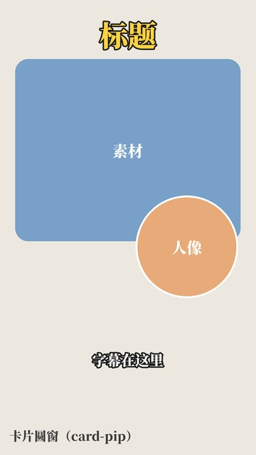
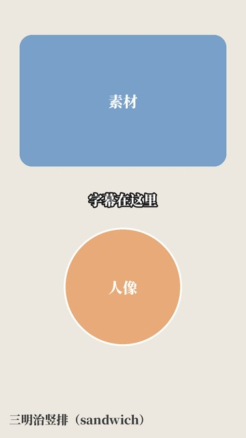
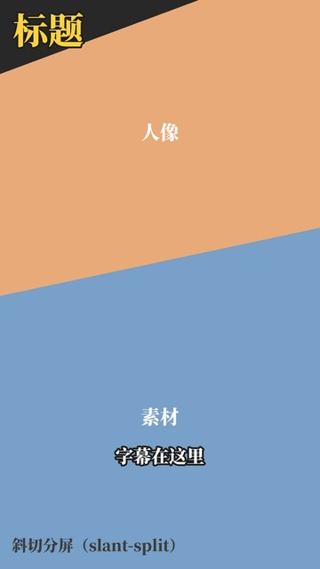
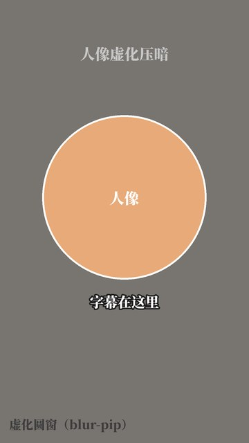
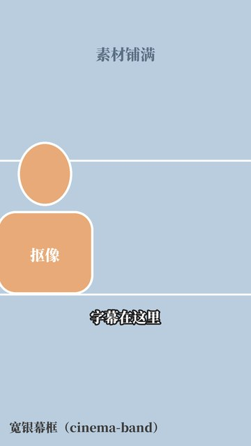
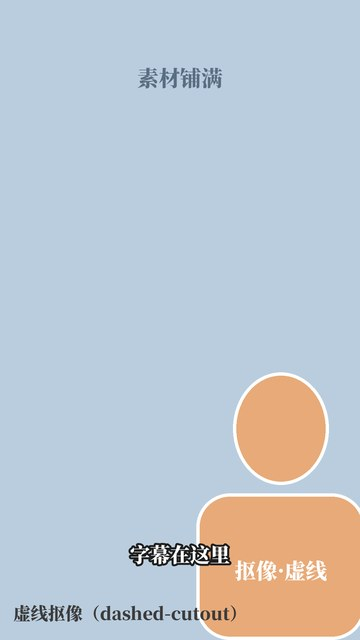
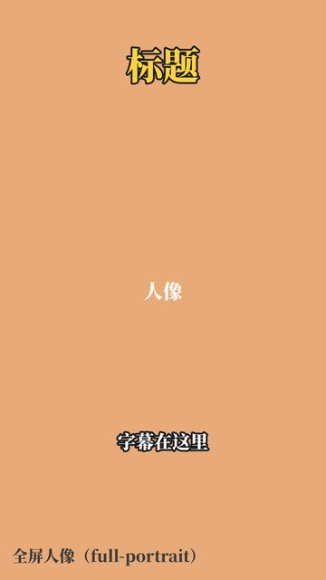

# 模板库

一个模板 = 几个维度取值的打包。维度是字段（[DIMENSIONS.md](../DIMENSIONS.md)），模板是零件，风格是一套搭好的组合（[styles/](../styles)）。

- **模板只定结构**：每块（素材、人像、字幕、标题）放哪、什么形状、怎么进场。
- **皮肤由风格填**：颜色、字体、字号写成 `accent`、`title`、`subtitle` 这样的引用，从 `styles/<风格>.json` 取。同一个模板放进不同风格，颜色和字体跟着风格变。
- **模板和风格多对多**：一个模板标明适用画幅（`aspect`），风格在 `templates` 一节里列出自己开放哪些、状态是 ✓ 还是 △。
- **取值按层覆盖**：风格默认 → 模板 → 系列 → 本集 → 单个镜头。风格禁用（✗）的值哪一层都不能用。

渲染器是 [`shared/templates/engine.py`](../shared/templates/engine.py)，`bash shared/sync.sh` 会把它和整个模板库复制进开放了模板的风格技能。

## 现有模板

### 镜头模板（`shots/`）

一个镜头里的排版。来源：2026-11-11 du 给的「六种口播排版」录屏，拆出 7 种，加一个全屏人像当形变的起点和终点。

| 线框 | id | 名字 | 版式类 | 要什么 | 状态 |
| --- | --- | --- | --- | --- | --- |
|  | `sticker-hook` | 描边贴纸人 | 全屏人像（抠像） | 人像、抠像 | △ |
|  | `card-pip` | 卡片圆窗 | 内容 + 人像小窗 | 人像、素材 | △ |
|  | `sandwich` | 三明治竖排 | 内容 + 人像小窗 | 人像、素材 | △ |
|  | `slant-split` | 斜切分屏 | 分屏 | 人像、素材 | △ |
|  | `blur-pip` | 虚化圆窗 | 内容 + 人像小窗 | 人像（素材可选） | △ |
|  | `cinema-band` | 宽银幕框 | 全屏内容 + 抠像 | 人像、素材、抠像 | △ |
|  | `dashed-cutout` | 虚线抠像 | 全屏内容 + 抠像 | 人像、素材、抠像 | △ |
|  | `full-portrait` | 全屏人像 | 全屏人像 | 人像 | ✓ |

### 片段模板（`sequences/`）

几个镜头模板按字幕句数串起来，加转场。现在三个都是开头。

| id | 名字 | 镜头顺序 | 要什么 |
| --- | --- | --- | --- |
| `opening-sticker` | 贴纸钩子开场 | 描边贴纸人（2 句）→ 卡片圆窗（2 句）→ 虚化圆窗 + 素材铺满 | 标题 `hook`、`topic`；1–2 段素材 |
| `opening-slant` | 斜切开场 | 斜切分屏（2 句）→ 宽银幕框（2 句）→ 虚线抠像 | 标题 `hook`；1–3 段素材 |
| `opening-pullback` | 全屏收圆窗开场 | 全屏人像（2 句）→ 虚化圆窗（1 句）→ 换素材铺满（1 句）→ 三明治竖排 | 标题 `hook`；1–2 段素材 |

元件模板（字幕样式、花字样式、标题样式）现在放在风格文件的 `text` 一节里，模板按名字引用；以后多了再拆出来。

## 文件格式

### 镜头模板

```jsonc
{
  "id": "card-pip", "name": "卡片圆窗", "kind": "shot", "status": "△",
  "aspect": ["9:16"],                 // 适用画幅，风格画幅对不上就不能用
  "layout_class": "内容 + 人像小窗",   // 维度 1 的版式类，✓ ✗ 规则管在这一层
  "needs": ["portrait", "content"],   // 还可能有 matting（要抠像）
  "dims": { "1 排版与布局": "…", "10 人像": "…" },   // 这个模板在各维度上取的值，给人看
  "background": { "type": "paper" },  // paper / content / portrait_blur / color，可加 blur、dim、lower_dim
  "layers": [                         // 从下往上画
    { "slot": "content",  "shape": "roundrect", "box": [0.06, 0.13, 0.88, 0.40], "radius": 0.05, "shadow": true },
    { "slot": "portrait", "shape": "circle", "box": [0.53, 0.43, 0.40, null], "face_width": 0.55,
      "ring": { "color": "white", "width": 0.008 }, "enter": "pop" },
    { "slot": "title",    "anchor": [0.5, 0.075], "text_style": "title_accent", "enter": "pop" },
    { "slot": "subtitle", "anchor": [0.5, 0.79],  "text_style": "subtitle" }
  ]
}
```

- 坐标都是画布的比例，`box` 是 `[x, y, 宽, 高]`；圆的高写 `null`，按宽算成正圆。
- `shape`：`rect`、`roundrect`、`circle`（这三种之间能形变）、`polygon`（给 `points`）、`cutout`（抠像，可加 `stroke` 实线或虚线描边、`bust` 把肩膀收圆、`align` 靠左右）。
- `slot`：`content`、`portrait`、`title`、`subtitle`，还有装饰用的 `panel`（色块）和 `lines`（横线）。
- 人像取景：`face_width` 是脸占框宽的比例，`face_y` 是脸在框里的高度（默认 0.42）。
- `enter` 进场：`pop` 弹出、`fade` 淡入、`rise` 上浮、`wipe` 刷出、`type` 逐字打出（字幕）、`draw` 画线、`slide_left` 从左滑入、`slide_down` 从上扫入（斜切）。
- 颜色和 `text_style` 都是风格文件里的名字，不写死色值。

### 片段模板

```jsonc
{
  "id": "opening-sticker", "kind": "sequence",
  "transition": { "type": "morph", "duration": 0.4 },   // morph 形变 / fade 叠化 / cut 硬切
  "shots": [
    { "template": "sticker-hook", "cues": 2, "title": "hook" },          // 占 2 句字幕，标题用任务里的 titles.hook
    { "template": "card-pip", "cues": 2, "title": "topic", "content": 0 }, // 用第 0 段素材
    { "template": "blur-pip", "cues": "rest", "content": 1,
      "background": { "type": "content", "dim": 0.3, "blur": 0.012 } }   // 镜头里可以覆盖模板的背景
  ]
}
```

形变转场：前后两个镜头里同一个 `slot`、都是 `rect / roundrect / circle` 的块，位置、大小、圆角一起插值，看起来是同一个画面在变；其他块淡入淡出。

### 任务文件（每集一份）

```jsonc
{
  "style": "koubo",
  "sequence": "opening-sticker",            // 或者直接写 "shots": [...] 自己排
  "portrait": { "src": "~/Downloads/11158.MP4", "start": 4.52 },   // 口播原片和开头在原片里的起点
  "cues": [[0.0, 1.73, "分享一个至今让我觉得"], …],                  // 字幕，时间从 start 起算
  "duration": 16.7,
  "content": [{ "src": "broll_1.mp4" }, { "src": "card.png", "push": 1.06 }],  // 素材：视频或图片（图片会缓推）
  "titles": { "hook": "这一刀\n差点白挨", "topic": "病程线" }
}
```

```bash
python engine.py list                              # 列出模板
python engine.py still  job.json 3.5 frame.jpg     # 先看一帧
python engine.py render job.json opening.mp4       # 出片，音频从原片同一段取
python engine.py wire   card-pip card-pip.jpg      # 出线框图
```

第一次用到抠像时，会把两个 MediaPipe 模型（人像分割、人脸位置，共约 16MB）下载到 `~/.cache/edit-skills/models`。

## 加一个新模板

1. 拿到参考视频，抽帧，把每种排版拆成维度取值。
2. 用到维度表里没有的值，先加进 [DIMENSIONS.md](../DIMENSIONS.md)，标 △。
3. 在 `shots/` 或 `sequences/` 写一份 json，跑 `wire` 出线框图放在旁边，在上面两张表里加一行。
4. 挂到要用它的风格：`styles/<风格>.json` 的 `templates` 里加上，状态先写 △。
5. 用真实素材出一段小样给 du 看，看过转 ✓。
6. `bash shared/sync.sh`。
